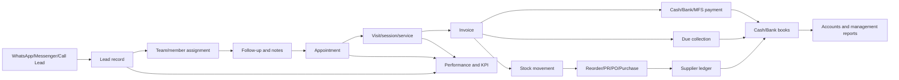
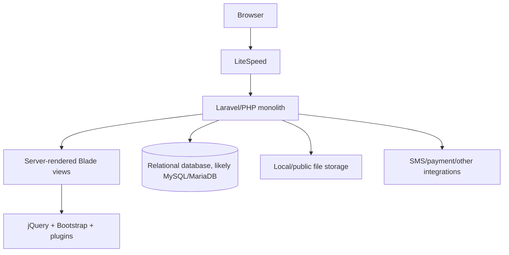
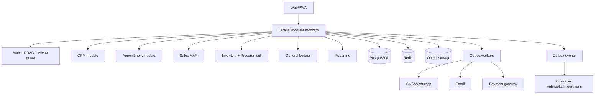
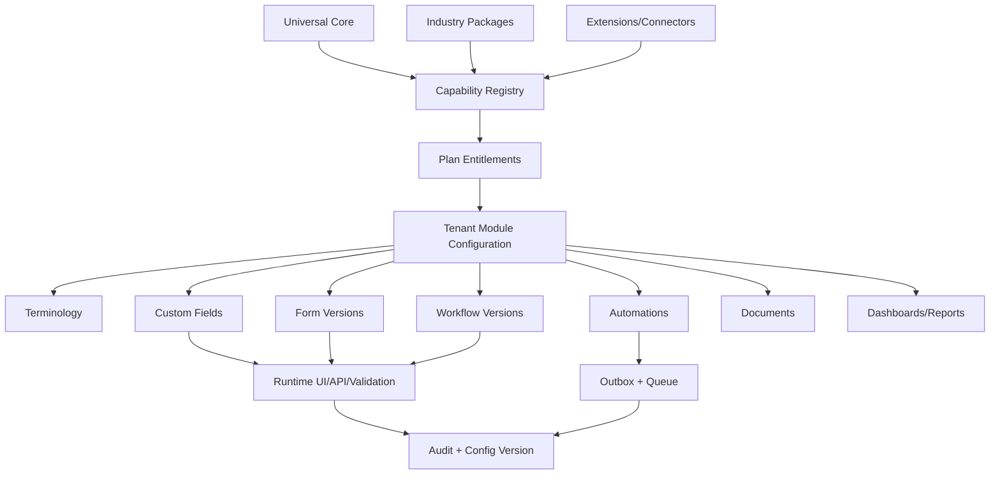

# BizNova-ধাঁচের ERP + CRM SaaS: সম্পূর্ণ প্রোডাক্ট ব্লুপ্রিন্ট

> অডিটের তারিখ: ১১ অক্টোবর ২০২৬ (Asia/Dhaka)  
> পর্যবেক্ষিত অ্যাপ: `https://app.biznova.app/admin`  
> ভাষা: সহজ বাংলা; প্রয়োজনীয় technical term ইংরেজিতে রাখা হয়েছে।

---

## ১. এই ডকুমেন্ট কী

এই ডকুমেন্টের তিনটি উদ্দেশ্য:

1. বর্তমানে খোলা BizNova/SukunLife অ্যাপটি কী করে, কীভাবে তৈরি হয়েছে বলে বোঝা যায় এবং কোথায় ভালো/খারাপ—তা ব্যাখ্যা করা।
2. একই শ্রেণির কিন্তু আরও নির্ভরযোগ্য, নিরাপদ, দ্রুত এবং একাধিক ব্যবসার কাছে বিক্রিযোগ্য SaaS product-এর পূর্ণ specification দেওয়া।
3. ChatGPT/Codex বা একটি software team-কে দিয়ে productটি বাস্তবে তৈরি করানোর জন্য copy-paste master prompt, phased plan এবং acceptance criteria দেওয়া।

### অডিটের সীমা

- Login করা অবস্থার dashboard, navigation, form, list, report এবং workflow read-only ভাবে পর্যবেক্ষণ করা হয়েছে।
- কোনো record create, edit, submit বা delete করা হয়নি।
- source code, database, private API, server configuration বা penetration test করা হয়নি।
- তাই framework ও architecture-এর কিছু অংশ দৃশ্যমান technical signal থেকে করা শক্তিশালী inference; source-code proof নয়।
- রোগী/lead/customer-এর বাস্তব নাম, ফোন বা অন্য ব্যক্তিগত তথ্য এই ডকুমেন্টে ইচ্ছাকৃতভাবে রাখা হয়নি।

---

## ২. এক লাইনে productটি কী

এটি একটি service-business-কেন্দ্রিক **ERP + CRM + Appointment + POS/Invoice + Inventory + Accounting + Reporting** web application। বর্তমান deploymentটি SukunLife-এর ruqyah, counselling, hijama ও related product business অনুযায়ী customize করা।

মূল শক্তি হলো: lead আসা থেকে appointment, service delivery, invoice, payment, stock, expense এবং management report—একই system-এ আনার চেষ্টা।

মূল দুর্বলতা হলো: feature অনেক, কিন্তু accounting ও inventory data integrity, privacy, UX consistency, maintainability এবং SaaS productization এখনও দুর্বল।

---

## ৩. বর্তমান অ্যাপে পাওয়া feature map

### ৩.১ Dashboard

- Today's Sales, Monthly Sales
- Collection এবং Monthly Collection
- Today's Due এবং মোট due invoice
- Today's Orders, monthly order, profit
- SMS balance এবং sent count
- Today's Purchases, monthly purchase
- Today's Expenses, monthly expense
- Cash balance
- Current stock value, item/quantity এবং oversold warning
- Quick action: invoice, expense, purchase, product create/search/list
- Quick links: barcode/label, company/brand, bank, customer/company ledger, stock, SMS, shop member approval
- সাত দিনের Sales vs Purchases chart
- ছয় মাসের Sales & Profit chart
- dashboard থেকেই report type ও date range দিয়ে report generate

### ৩.২ Report Center

#### Sales ও Purchase

- Sales report
- Day-wise sales summary
- Product-wise sales
- Product sales summary
- Customer-wise sales details
- Category-wise sales
- Salesman-wise sales
- Sales profit
- Purchase ও purchase details
- Commission earned/commission report
- Production ও production sales
- Sales investigation

#### Cash, Bank ও Expense

- Payment report
- Expense report
- Cash sheet
- Cash book ও day-wise summary
- Bank book
- Cash and bank position
- Supplier book ও summary
- Bank transaction report

#### Customer ও Party

- Customer ledger ও balance
- Customer list
- Market due
- Customer/company/supplier ledger summary
- Due collection report

#### Stock ও Product

- Stock, raw-material stock ও product stock
- Product list
- Opening stock ও opening balance
- Pending stock approval
- Store-wise stock
- Exchange item ও exchange wastage
- Barcode/label print

#### CRM এবং Other

- Performance Center
- Practitioner/agent/raqi activity—person-wise ও patient-wise
- CRM activity
- Appointment activity
- Team, appointment এবং lead report
- Commission, loan ও investment report
- Log books
- Ledger health

### ৩.৩ Performance Center ও KPI

- Lead, appointment, completed, cancelled এবং session totals
- Lead-to-appointment ও appointment-to-completed conversion
- Team member performance
- Lead source share (যেমন WhatsApp/Messenger/Direct)
- Appointment status distribution
- Practitioner/service-provider activity
- Session, patient, service মিনিট, prescription, history, consultation, follow-up count
- Service-wise bill, discount, payment এবং due
- Patient/lead search করে service history
- Activity-log-ভিত্তিক attendance, check-in/check-out এবং কাজের ঘণ্টা

### ৩.৪ Accounts

- Balance Sheet / Statement of Financial Position
- Income & Expenditure
- Chart of Accounts
- Account/head mapping
- Opening balances
- Asset, liability, equity, income এবং expense hierarchy
- Cash-basis reporting

### ৩.৫ Leads, CRM ও Follow-up

- New lead এবং all leads
- Hot/Warm/Cold এবং অন্যান্য status/type
- WhatsApp/Messenger/Direct Call source
- Team ও member assignment
- Notes এবং next follow-up date
- Search/filter by date, name, phone, code, source, member, team
- Lead থেকে appointment book
- Diagnosis/intake questionnaire
- To-do, notes, KPI analysis
- Team members ও teams

### ৩.৬ Appointment এবং service operation

- New appointment, list এবং calendar
- Today/previous/next-day navigation
- Date, service, room, creator, status এবং patient/lead search
- Status: Pending, Booked, Called, Visiting, Completed, Re-schedule, Cancelled, Refund
- Re-schedule reason
- Room, slot এবং slot-availability management
- Doctor/practitioner management
- Appointment থেকে invoice link
- PDF/print ও Excel export

### ৩.৭ Sales, invoice ও collection

- New invoice ও invoice list
- Store selection
- Existing/new customer, phone, address, date
- Product/service, variant, quantity, unit price, amount
- Total, discount code, discount, net bill
- Cash, bank ও MFS split payment
- Previous due, today's due, net due
- Paid/draft state
- Notes
- Due invoice, payment collection, bulk collection, payment invoice
- Customer/dealer/partner records

### ৩.৮ Expense ও income

- General expense, single entry, salary expense
- Expense head, amount, description, voucher, payment method, date
- Multiple expense row entry
- Cash receive/income head ও date
- Recent এবং all expense

### ৩.৯ Procurement

- Purchase requisition (PR)
- Purchase order (PO)
- Draft → Pending → Approved → Received/Rejected lifecycle-এর ভিত্তি
- Supplier/title, quantity, total, required-by date, estimate
- Purchase invoice/direct purchase
- Supplier bill ও purchase total

### ৩.১০ Product, stock ও inventory

- Product/service/fixed asset/category
- Code, image, measurement unit, cost/price
- Opening balance ও bulk entry
- Barcode/label print
- Current stock report এবং stock valuation
- Stock adjustment
- Store/warehouse
- Store-to-store transfer ও history
- Store-wise stock
- Visibility state

### ৩.১১ Production

- Production entry ও production list
- Date/product/quantity filter
- BOM/formula: raw material in, finished product out
- Production report

### ৩.১২ Supplier, banking, shop ও communication

- Company/supplier list ও ledger
- Bank/MFS account এবং transaction report
- SMS balance
- Shop member approval ও approved members
- Contact/support dashboard-এর link

---

## ৪. বাস্তব end-to-end workflow



এই workflowটাই productটির সবচেয়ে বিক্রিযোগ্য value: owner এক জায়গা থেকে customer journey, operation এবং টাকা দেখতে পারে।

---

## ৫. বর্তমান app কীভাবে তৈরি হয়েছে বলে বোঝা যায়

### ৫.১ Backend-এর শক্তিশালী inference

- HTTP response-এ `X-Powered-By: PHP/8.3.35` দেখা গেছে।
- session cookie-এর নাম `biznova_erp_session` এবং `XSRF-TOKEN` cookie আছে।
- HTML form-এ `_token`, Laravel-ধাঁচের routes এবং CSRF pattern আছে।
- তাই backendটি PHP Laravel application হওয়ার সম্ভাবনা খুব বেশি।
- web server হিসেবে LiteSpeed ব্যবহৃত হচ্ছে।
- UI server-rendered; প্রতিটি module আলাদা route/page load করছে। এটি SPA নয়।

### ৫.২ Frontend stack-এর দৃশ্যমান প্রমাণ

- Bootstrap
- jQuery
- jQuery UI
- Ace Admin template/style
- Font Awesome
- DataTables এবং export/print extensions
- Select2, Chosen, Bootstrap Select
- Chart.js
- Moment.js + Date Range Picker
- Summernote rich-text editor
- FileSaver এবং Word export plugin
- custom per-page JavaScript/CSS

### ৫.৩ বর্তমান architecture-এর সম্ভাব্য রূপ



### ৫.৪ ভালো দিক

- ছোট team দিয়ে দ্রুত feature বানানোর জন্য monolith উপযুক্ত।
- Laravel-style CSRF protection আছে—এটি ইতিবাচক।
- familiar table/form UI হওয়ায় office staff দ্রুত শিখতে পারে।
- domain-specific রিপোর্ট ও Bengali labels বাস্তব কাজের সঙ্গে মিলেছে।
- বহু module একই session ও একই dataset ব্যবহার করছে।

### ৫.৫ technical debt-এর লক্ষণ

- একই page-এ `jquery-ui.js` এবং `jquery-ui.min.js`—দুই সংস্করণই load হচ্ছে বলে দেখা গেছে।
- প্রয়োজন না থাকলেও DataTables, Summernote, dual listbox, theme customizer ইত্যাদি বহু asset প্রায় সব page-এ load হচ্ছে।
- template-এর theme/zoom/sidebar controls DOM-এ প্রতিটি page-এ আছে।
- page-specific script ও global plugin-এর মিশ্রণ upgrade ও debugging কঠিন করে।
- UI pattern ও ভাষা consistent নয়।
- server-side view-এ repeated modal/form markup থাকার কারণে page size বড় হওয়ার সম্ভাবনা।

---

## ৬. সবচেয়ে গুরুত্বপূর্ণ সমস্যা

### ৬.১ P0 — Accounting data বিশ্বাসযোগ্য নয়

পর্যবেক্ষিত Balance Sheet নিজেই জানিয়েছে:

- statement balance করছে না;
- difference আনুমানিক ৳৪১.৫ লাখ;
- opening balance নেই;
- ১১টি head mapped নয় এবং Suspense-এ গেছে;
- journal entry system নেই;
- unpaid invoice, unpaid bill, inventory, depreciation ও provision পূর্ণভাবে balance sheet-এ নেই।

#### প্রভাব

Owner dashboard-এর profit/cash/asset দেখে ভুল business decision নিতে পারে। Auditor বা accountant systemটি বিশ্বাস করবে না। ERP বিক্রির ক্ষেত্রে এটি সবচেয়ে বড় blocker।

#### সমাধান

- immutable double-entry general ledger
- প্রত্যেক financial event-এর balanced debit/credit posting
- invoice, payment, purchase, expense, refund, stock valuation, depreciation-এর posting rules
- accounting period lock
- reversal entry; financial transaction hard-delete নিষিদ্ধ
- bank reconciliation
- accounts receivable/payable
- trial balance always balanced invariant
- opening balance migration assistant
- suspense account dashboard ও unresolved mapping alert

### ৬.২ P0 — Stock data ও service model ভাঙা

Dashboard এবং stock report-এ বহু negative/oversold item দেখা গেছে। Service item-ও stock quantity হিসেবে negative হয়েছে।

#### মূল কারণ হতে পারে

- sale-এর আগে available stock validation নেই;
- product ও service একই inventory logic ব্যবহার করছে;
- opening stock/purchase/transfer যথাযথভাবে record হয়নি;
- historical adjustment হয়েছে কিন্তু audit trail যথেষ্ট নয়;
- unit conversion ও fractional quantity rule অস্পষ্ট।

#### সমাধান

- `item_type = stock | non_stock | service | asset | raw_material | finished_good`
- service কখনো stock decrement করবে না
- stock ledger হবে source of truth; product table-এ হাতে balance edit নয়
- movement types: opening, purchase_receive, sale, sale_return, purchase_return, transfer_out, transfer_in, production_consume, production_output, adjustment, damage
- configurable negative-stock policy; default block
- store, batch, expiry, serial, unit conversion
- backdated transaction policy এবং recalculation job
- physical stock count ও approval workflow

### ৬.৩ P0 — Privacy ও sensitive health/CRM data

Lead ও appointment list-এ phone number, personal details এবং health-related intake field আছে। Export/printও করা যায়। এটি সাধারণ CRM data-এর চেয়ে বেশি sensitive।

#### দরকার

- least-privilege RBAC
- field masking: phone/NID/medical note role অনুযায়ী আংশিক দেখানো
- every view/export/print/download audit log
- consent, purpose এবং retention policy
- encrypted backups; sensitive columns application-level encryption যেখানে দরকার
- session revocation, 2FA, device/session list
- export watermark ও rate limit
- tenant isolation test
- legal counsel দিয়ে privacy notice, data processing agreement ও retention schedule review

### ৬.৪ P0 — Security hardening অসম্পূর্ণ

Unauthenticated `/admin` response header-এ HTTPS ও secure/HttpOnly session cookie ছিল—ভালো। তবে পরীক্ষিত response-এ নিচের headers দেখা যায়নি:

- `Strict-Transport-Security`
- `Content-Security-Policy`
- `X-Content-Type-Options`
- `X-Frame-Options` অথবা CSP `frame-ancestors`
- `Referrer-Policy`
- `Permissions-Policy`

এছাড়া `X-Powered-By: PHP/8.3.35` unnecessary version disclosure। এটি exploitation proof নয়; hardening gap।

#### সমাধান

- security headers
- remove version disclosure
- dependency scanning ও patch policy
- rate limit, lockout, bot protection
- secure password policy + 2FA
- server-side authorization on every route/action
- CSRF + output encoding + strict validation
- upload MIME/type/size scanning
- secret manager; credentials কখনো repo-তে নয়
- OWASP ASVS-aligned review এবং annual independent penetration test

### ৬.৫ P1 — Dashboard ও navigation অতিরিক্ত ভিড়

- Sidebar খুব লম্বা এবং module grouping সত্ত্বেও first-time user-এর cognitive load বেশি।
- screenshot-এ expanded sidebar content-এর অংশ ঢেকে দিচ্ছিল।
- একই dashboard-এ অনেক card, quick action, quick link, report selector ও chart আছে।
- icon-only top shortcuts-এর accessible label দৃশ্যমান নয়।

#### সমাধান

- role-based home dashboard
- owner, sales, front desk, accounts, inventory—প্রত্যেকের আলাদা default workspace
- global command/search palette
- Recent/Favourites
- “Needs attention” inbox: overdue lead, due invoice, stockout, unmapped head, failed sync
- mobile-first responsive sidebar/drawer
- keyboard navigation এবং WCAG 2.2 AA

### ৬.৬ P1 — ভাষা ও UX inconsistent

- Bengali ও English একই table/form-এ এলোমেলোভাবে মিশেছে।
- `Cancelled`/`Canceled`, `Raqi/Doctor/Member`, `Customer/Patient/Lead` terminology inconsistent।
- old admin template controls business screen-এর সঙ্গে মিশে আছে।
- কিছু action icon-only; destructive action row-এর কাছে বেশি।

#### সমাধান

- proper i18n translation catalog (`bn-BD`, `en`)
- domain glossary
- consistent button hierarchy
- form validation message ও error recovery
- unsaved-change guard
- destructive action-এর reason, impact preview ও permission
- product design system

### ৬.৭ P1 — KPI definition ও attendance ভুল বোঝাতে পারে

- কিছু conversion rate ১০০%-এর বেশি হয়েছে—lead ও appointment-এর time window বা attribution mismatch হতে পারে।
- activity log-এর first/last eventকে attendance হিসেবে ধরা হয়েছে; এটি প্রকৃত employee attendance নয়।
- midnight activity থাকলে hours অস্বাভাবিক হতে পারে।

#### সমাধান

- metric dictionary: numerator, denominator, attribution, time zone, exclusion
- cohort-based funnel
- duplicate lead merge
- proper attendance/check-in integration বা featureটির নাম “System activity span” করা
- data freshness ও last-calculated timestamp

### ৬.৮ P1 — Multi-tenant SaaS readiness দেখা যায়নি

এক ব্যবসা থেকে বহু ব্যবসার কাছে product বিক্রি করতে লাগবে:

- tenant/workspace
- per-tenant branding, currency, tax, timezone, language, fiscal year
- subscription, plan, usage limit, billing
- tenant admin ও support impersonation with approval/audit
- tenant-safe jobs, cache, storage, search, export
- automated onboarding, demo data, import

### ৬.৯ P2 — Integration ও automation gap

- WhatsApp/Messenger lead source আছে, কিন্তু native conversation sync/attribution প্রমাণ পাওয়া যায়নি।
- payment reconciliation, e-commerce, accounting export, webhook/API, email automation, document OCR—এসব productization-এর জন্য দরকার।

---

## ৭. নতুন product-এর অবস্থান

### ৭.১ নামের placeholder

`NovaFlow ERP` — পরে brand research করে final করা হবে।

### ৭.২ Positioning

“বাংলাদেশের service ও distribution SME-র জন্য lead থেকে cash এবং stock থেকে accounts—এক জায়গার operating system।”

### ৭.৩ প্রথম vertical

সবার জন্য generic ERP দিয়ে শুরু না করে একটি vertical বেছে নিন:

1. clinic/wellness/service center — current domain-এর সবচেয়ে কাছাকাছি;
2. distributor/wholesaler — inventory ও due-heavy;
3. small manufacturer — BOM/production-heavy;
4. agency/field-service — CRM/appointment-heavy।

প্রথমে clinic/wellness version launch করলে বর্তমান শেখা সবচেয়ে বেশি reuse হবে। Core engine generic থাকবে; vertical-specific fields package/extension হবে।

---

## ৮. Recommended product architecture

### ৮.১ কেন modular monolith

শুরুতেই microservice করলে cost, deployment, debugging ও data consistency জটিল হবে। ১০–৩০ developer এবং কয়েক হাজার tenant পর্যন্ত একটি ভালো modular monolith যথেষ্ট। Module boundary ও event contract ঠিক রাখলে পরে প্রয়োজনীয় service আলাদা করা যাবে।

### ৮.২ Recommended stack

#### Application

- Backend: **Laravel 13**, PHP 8.4/8.5 supported combination project start-এ verify করতে হবে
- Frontend: **Inertia.js + React + TypeScript**
- UI: Tailwind CSS + accessible headless components; custom design system
- Database: PostgreSQL
- Cache/queue/rate limit: Redis
- Search: PostgreSQL full-text শুরুতে; পরে Meilisearch/OpenSearch
- Realtime: Laravel Reverb/WebSocket বা managed provider
- Files: S3-compatible storage, যেমন Cloudflare R2
- Background work: Laravel queue workers
- PDF: server-side HTML-to-PDF with Bengali font embedding
- Excel/CSV: queued exports
- Email: transactional email provider
- SMS/WhatsApp: provider abstraction
- Payments: SSLCOMMERZ adapter, পরে অন্য gateway

#### Engineering

- Docker Compose local development
- GitHub Actions CI/CD
- PHPUnit/Pest + Playwright
- static analysis: PHPStan/Larastan
- formatter: Pint + ESLint/Prettier
- OpenAPI contract
- Sentry/OpenTelemetry-compatible monitoring
- infrastructure as code

### ৮.৩ High-level architecture



### ৮.৪ Multi-tenancy

শুরুতে shared database/shared schema ব্যবহার করা যায়:

- প্রতিটি business table-এ `tenant_id` mandatory
- composite indexes-এ tenant প্রথম column
- global scope একা যথেষ্ট নয়; policy ও integration test লাগবে
- background job-এ explicit tenant context
- cache key ও object-storage path-এ tenant prefix
- tenant-aware unique constraints
- enterprise plan-এ separate database option
- support impersonation only with tenant-admin approval, reason এবং audit log

### ৮.৫ Universal customization strategy

Productটি “সব ধরনের ব্যবসার জন্য একটি বিশাল fixed ERP” হবে না। এটি হবে তিন স্তরের platform:

```text
Universal Core (প্রায় 70%)
        +
Industry Package (প্রায় 20%)
        +
Tenant Configuration / Integration (প্রায় 10%)
```

#### Universal Core

যে capability প্রায় সব business-এ লাগে:

- organization, branch, user, role ও approval
- contact/customer/supplier
- product/service/catalog
- CRM, task ও communication
- order, invoice, payment ও due
- purchase ও expense
- inventory এবং accounting
- document, report, notification ও audit

#### Industry Package

একটি installable package নির্দিষ্ট industry-এর terminology, fields, workflow, role, dashboard, report এবং seed configuration একসঙ্গে activate করবে। উদাহরণ:

| Package | অতিরিক্ত capability |
|---|---|
| Clinic/Wellness | patient, practitioner, appointment, room, intake, consent, prescription/session |
| Retail/POS | counter, shift, cash drawer, barcode checkout, return, loyalty |
| Distribution | dealer, territory, sales rep, credit limit, delivery, collection route |
| Manufacturing | BOM, work order, material issue, production, wastage, quality check |
| Education | student, guardian, course, batch, class, attendance, fee |
| Agency/Field Service | project/job, quotation, technician, visit, timesheet, service report |
| Restaurant | menu/modifier, table, kitchen ticket, recipe, wastage, delivery |
| Real Estate | property, unit, inquiry, site visit, booking, installment, handover |

Industry package কখনো core code copy করবে না। এটি versioned manifest এবং configuration/extension hook-এর মাধ্যমে core module ব্যবহার করবে।

#### Tenant Configuration

প্রতিটি business admin code ছাড়া configure করতে পারবে:

- business identity, logo, color, domain ও document branding
- currency, language, timezone, fiscal year ও number format
- module enable/disable
- branch, store, warehouse ও department
- terminology: Customer → Patient/Student/Member/Client
- custom fields ও form layout
- pipeline, status ও workflow
- role/permission ও approval matrix
- invoice/document number এবং template
- tax, discount, price list ও payment method
- dashboard widget ও saved report
- email/SMS/WhatsApp notification template
- data retention, consent ও field masking policy

### ৮.৬ Customization-এর চারটি স্তর

| Level | কী বদলাবে | কে করবে | Core deploy লাগবে? |
|---|---|---|---|
| L1 Branding | logo, color, domain, PDF, terminology | Customer admin | না |
| L2 Configuration | field, form, pipeline, workflow, role, automation | Customer admin/partner | না |
| L3 Industry Package | industry module, report, dashboard, template | Product team/certified partner | package release |
| L4 Extension | uncommon logic বা external integration | Certified developer | isolated extension deploy |

L1–L2 পরিবর্তন self-service হবে। L3 curated এবং versioned। L4 public extension API/SDK দিয়ে হবে; core source fork করে নয়।

### ৮.৭ Client-specific code fork নিষিদ্ধ

এক customer-এর জন্য আলাদা repository/branch করলে:

- bug fix ও security update সব customer-এ পৌঁছায় না;
- একই feature বহুবার maintain করতে হয়;
- database migration বিভক্ত হয়;
- support ও testing cost দ্রুত বাড়ে;
- SaaS gross margin নষ্ট হয়।

নীতিমালা:

- একটি codebase ও একটি release train
- tenant configuration database-driven
- feature flag entitlement/rollout-এর জন্য, permanent custom code লুকানোর জন্য নয়
- reusable requirement industry package-এ
- uncommon integration extension adapter-এ
- কোনো client override core accounting, stock, security বা audit invariant বদলাতে পারবে না

### ৮.৮ Custom Field এবং Form Builder

#### Supported field types

- short/long text
- integer/decimal/currency/percentage
- date/datetime/time
- single/multi select
- checkbox/radio
- phone/email/URL/address
- file/image
- user/team/entity reference
- formula/read-only derived field—safe expression set থেকে

#### Field configuration

- label ও translated label
- entity/module
- required/optional
- default value
- validation rule
- visibility/edit permission
- searchable/filterable/sortable
- report/export eligibility
- sensitive/masked/encrypted classification
- retention policy
- conditional visibility
- display order ও section

#### Storage strategy

- core reporting/financial field normalized column/table-এ থাকবে;
- optional custom values typed custom-value table-এ থাকবে;
- configuration PostgreSQL JSONB-তে রাখা যেতে পারে;
- সব business data একটি unvalidated JSON blob-এ রাখা যাবে না;
- searchable custom field-এর indexed projection থাকতে হবে;
- schema/config version এবং migration hook থাকতে হবে।

#### Form builder

- field palette, sections, columns এবং step
- role/channel-specific form variants
- conditional show/hide
- draft ও preview
- validation simulator
- mobile preview
- published version pinning—পুরনো submission কোন version ব্যবহার করেছে জানা যাবে

### ৮.৯ Workflow এবং Automation Builder

Workflow একটি versioned state machine হবে:

```text
State + Transition + Guard + Action + SLA + Audit
```

Business admin configure করতে পারবে:

- states/statuses
- allowed transitions
- transition কে চালাতে পারবে
- required field/checklist
- single/multi-level approval
- timer/SLA/overdue escalation
- transition-এর পরে task, notification, document বা webhook
- conditional branch using approved safe operators

#### Safety boundary

Admin arbitrary PHP/JavaScript/SQL লিখতে পারবে না। Workflow engine declarative rule DSL ব্যবহার করবে। Financial posting, payment verification, stock valuation, tenant security ও audit core-controlled থাকবে।

#### Automation example

```text
Trigger: Appointment starts in 24 hours
Condition: status = Booked AND reminder_opt_in = true
Actions: enqueue SMS + WhatsApp reminder
Failure: retry 3 times, then create attention item
```

Automation-এ idempotency, rate limit, retry, dead-letter, execution log এবং dry-run preview বাধ্যতামূলক।

### ৮.১০ Document, dashboard ও report customization

#### Document Template Studio

- invoice, quotation, receipt, appointment slip, purchase order
- logo, header/footer, field token, table, signature ও QR/barcode
- Bengali font embedding
- test-data preview
- template versioning ও rollback
- safe template syntax; server code execution নয়

#### Dashboard Builder

- approved widget catalog
- role-based default layout
- branch/date filter
- threshold/alert
- metric definition এবং data freshness
- arbitrary SQL widget নয়

#### Report Builder

- curated dataset/semantic layer
- allowed dimension, measure ও filter
- saved report, schedule ও export
- row/column-level permission
- query cost/time limit
- custom SQL শুধু internal trusted developer environment-এ

### ৮.১১ Extension এবং integration platform

#### Extension types

- connector/adaptor
- custom action
- import/export transformer
- report dataset/widget
- industry package
- notification provider

#### Extension contract

- versioned manifest: ID, version, compatibility, permissions, scopes
- explicit tenant installation ও consent
- signed package/release
- lifecycle: install, configure, migrate, enable, disable, uninstall
- sandboxed execution বা isolated worker where practical
- no direct unrestricted database access
- stable service/API/event contracts
- resource/time/rate limit
- audit, health ও failure visibility
- secret vault

#### প্রথম public events

```text
lead.created
lead.stage_changed
appointment.booked
appointment.completed
invoice.posted
payment.received
stock.low
purchase.received
journal.posted
```

### ৮.১২ Customization Studio user experience

Tenant Admin-এর আলাদা `Customization Studio` থাকবে:

1. Business Profile
2. Modules
3. Terminology
4. Fields
5. Forms
6. Workflows
7. Roles & Approvals
8. Automations
9. Documents
10. Dashboards & Reports
11. Integrations
12. Industry Packages

প্রতিটি change lifecycle:

```text
Draft → Validate → Preview/Sandbox → Publish → Monitor → Rollback
```

Publish-এর আগে impact দেখাতে হবে: কোন form/report/API/automation প্রভাবিত হবে, কত existing record আছে এবং কোনো required-field migration লাগবে কি না। Published config immutable version হিসেবে থাকবে; rollback নতুন version তৈরি করবে।

### ৮.১৩ Configuration governance এবং non-customizable core

নিচের জিনিস tenant বা plugin পরিবর্তন করতে পারবে না:

- authentication ও tenant isolation
- permission evaluation engine
- payment authenticity verification
- debit = credit accounting invariant
- immutable journal/stock/audit ledger
- stock quantity calculation
- encryption/secret-handling policy
- backup ও disaster-recovery rule
- platform-wide security headers ও validation baseline

Config change-এর জন্যও `view`, `draft`, `publish`, `rollback` এবং `install_extension` আলাদা permission হবে। Sensitive change-এ maker-checker approval রাখা যাবে।

### ৮.১৪ Configuration architecture



---

## ৯. Domain modules এবং acceptance criteria

### ৯.১ Identity, tenant ও access

#### Features

- signup/invite/login/logout/password reset/2FA
- organization/workspace
- branches/stores
- roles, permissions, custom roles
- session/device management
- audit log

#### Acceptance criteria

- tenant A-এর user tenant B-এর ID আন্দাজ করেও কোনো data পাবে না—404/403 হবে এবং test থাকবে।
- financial delete permission আলাদা।
- export permission view permission থেকে আলাদা।
- সব create/update/status/export/login/impersonation event audit হবে।

### ৯.২ CRM

#### Entities

- Lead, Contact, Customer/Patient, Source, Campaign, Pipeline, Stage
- Assignment, Team, Note, Task, Follow-up, Activity
- custom fields ও tags
- consent এবং communication preference

#### Acceptance criteria

- phone normalize করে duplicate suggestion
- lead merge করলে activity/history হারাবে না
- source/campaign attribution preserved
- stale/unassigned lead SLA alert
- Kanban ও table—দুই view

### ৯.৩ Appointment

- Service, practitioner, room/resource, slot, schedule, leave
- booking, reschedule, cancel, no-show, check-in, start, complete
- conflict detection
- reminder
- waitlist
- deposit/payment link

#### Acceptance criteria

- একই room/practitioner/time double-book হবে না।
- timezone-aware storage UTC; display tenant timezone।
- reschedule history immutable থাকবে।
- cancel/refund policy configurable।

### ৯.৪ Sales, invoice ও receivable

- quotation/order/invoice/credit note
- product/service lines
- tax, discount, coupon
- cash/bank/MFS split payment
- due schedule, collection, receipt
- POS mode
- print/PDF/email/WhatsApp share

#### Financial rule

Money database-এ floating-point নয়; smallest currency unit integer/decimal fixed precision। সব calculation server-side authoritative।

### ৯.৫ Product ও inventory

- SKU, barcode, variant, unit, category, price list
- stock/non-stock/service/raw/finished/asset type
- warehouse/store/bin
- batch, expiry, serial optional
- reorder level
- stock count, adjustment, transfer
- valuation method initially weighted average; FIFO optional later

#### Inventory invariants

- stock balance = sum of immutable stock ledger movements
- received transfer ছাড়া destination stock বাড়বে না
- cancelled document reverse movement তৈরি করবে; old movement delete নয়
- service item stock ledger-এ যাবে না
- negative stock default blocked

### ৯.৬ Procurement

- PR → approval → PO → receive → supplier invoice → payment
- partial receive এবং backorder
- supplier quotation comparison optional
- three-way match: PO vs goods receipt vs invoice

### ৯.৭ Production

- BOM version
- input/output/scrap/by-product
- work order
- material issue
- completion
- production costing
- variance report

### ৯.৮ Accounting

#### Core

- Chart of Accounts
- fiscal year/period
- journal entry ও journal lines
- AR, AP, cash, bank, tax
- bank reconciliation
- opening balance
- trial balance, general ledger, P&L, balance sheet, cash flow

#### Double-entry invariants

- প্রতিটি posted journal-এ total debit = total credit
- posted entry edit/delete নয়; reversal + replacement
- closed period-এ posting block
- source document ও journal entry link
- idempotency key duplicate posting ঠেকাবে
- account mapping ছাড়া operational event post হতে পারবে না; draft/exception queue-তে যাবে

### ৯.৯ Reporting

- role-based dashboards
- filters saved views
- export queue
- metric dictionary
- data freshness timestamp
- scheduled report
- tenant timezone/fiscal year aware

### ৯.১০ Notification/integration

- template engine
- email/SMS/WhatsApp adapters
- outbox pattern
- signed webhook with retry/dead-letter
- per-tenant credential vault
- delivery log এবং opt-out

---

## ১০. Core data model

### ১০.১ Shared foundation

```text
tenants
tenant_settings
branches
users
tenant_memberships
roles
permissions
role_permissions
user_roles
audit_logs
files
custom_field_definitions
custom_field_values
capabilities
modules
plans
plan_entitlements
tenant_module_settings
terminology_overrides
form_definitions
form_versions
workflow_definitions
workflow_versions
automation_rules
automation_executions
document_templates
document_template_versions
dashboard_layouts
report_definitions
industry_packages
industry_package_versions
tenant_package_installations
extensions
extension_versions
tenant_extension_installations
configuration_versions
configuration_publications
```

### ১০.২ CRM ও appointment

```text
contacts
leads
lead_sources
campaigns
pipelines
pipeline_stages
lead_assignments
activities
notes
tasks
follow_ups
services
practitioners
rooms
schedules
appointments
appointment_status_history
intake_forms
intake_submissions
consents
```

### ১০.৩ Commerce ও inventory

```text
items
item_variants
units
categories
price_lists
warehouses
stock_movements
stock_lots
stock_counts
stock_transfers
sales_orders
invoices
invoice_lines
credit_notes
payments
payment_allocations
suppliers
purchase_requisitions
purchase_orders
goods_receipts
supplier_invoices
```

### ১০.৪ Production ও accounting

```text
boms
bom_inputs
bom_outputs
work_orders
production_movements
accounts
fiscal_periods
journals
journal_lines
bank_accounts
bank_statement_lines
reconciliations
tax_rates
```

### ১০.৫ গুরুত্বপূর্ণ database rules

- primary key: ULID/UUID
- every tenant-owned row: non-null `tenant_id`
- timestamps: UTC
- money: `numeric(19,4)` বা minor-unit integer—একটি convention project-wide
- optimistic locking/version যেখানে concurrent edit হতে পারে
- soft delete শুধু non-financial master data-তে
- financial/stock ledger append-only
- foreign keys এবং unique/index design বাধ্যতামূলক
- PII field list ও retention metadata
- configuration-এর draft/published version এবং immutable publication history
- package/extension compatibility constraint
- custom-field value-এর type-safe constraint এবং indexed searchable projection

---

## ১১. API outline

Prefix: `/api/v1`

```text
POST   /auth/login
POST   /auth/2fa/verify
GET    /me
GET    /tenants/{tenant}/dashboard

GET    /leads
POST   /leads
GET    /leads/{id}
PATCH  /leads/{id}
POST   /leads/{id}/assign
POST   /leads/{id}/merge
POST   /leads/{id}/appointments

GET    /appointments
POST   /appointments
POST   /appointments/{id}/reschedule
POST   /appointments/{id}/cancel
POST   /appointments/{id}/complete

GET    /items
POST   /items
GET    /inventory/balances
POST   /stock-adjustments
POST   /stock-transfers

POST   /invoices
POST   /invoices/{id}/post
POST   /invoices/{id}/payments
POST   /invoices/{id}/credit-notes

POST   /purchase-requisitions
POST   /purchase-orders
POST   /goods-receipts

GET    /accounting/trial-balance
GET    /accounting/profit-and-loss
GET    /accounting/balance-sheet
POST   /journals
POST   /journals/{id}/post
POST   /journals/{id}/reverse

POST   /exports
GET    /exports/{id}
POST   /webhooks/{provider}

GET    /configuration/modules
PATCH  /configuration/modules/{module}
GET    /configuration/terminology
PUT    /configuration/terminology/{key}
GET    /custom-fields
POST   /custom-fields
POST   /forms
POST   /forms/{id}/versions
POST   /forms/{id}/versions/{version}/validate
POST   /forms/{id}/versions/{version}/publish
POST   /workflows
POST   /workflows/{id}/versions/{version}/simulate
POST   /workflows/{id}/versions/{version}/publish
POST   /automations/{id}/dry-run
POST   /document-templates/{id}/preview
GET    /industry-packages
POST   /industry-packages/{id}/install
POST   /industry-packages/{id}/upgrade
GET    /extensions
POST   /extensions/{id}/install
POST   /configuration/validate
POST   /configuration/publish
POST   /configuration/{version}/rollback
```

### API rules

- OpenAPI 3.1 documentation
- cursor pagination
- structured filter/sort
- idempotency key on payment/posting/receive endpoints
- request ID এবং trace ID
- consistent error envelope
- rate limit tenant + user + IP অনুযায়ী
- webhook signature, timestamp tolerance ও replay protection
- configuration publish endpoint idempotent হবে এবং optimistic version check করবে
- package/extension install-এর আগে dependency, permission ও compatibility preview দেবে
- workflow/form/document preview synthetic বা explicitly selected test data ব্যবহার করবে

---

## ১২. UI/UX specification

### ১২.১ Navigation

- ৬টি primary area: Home, CRM, Schedule, Sales, Operations, Finance
- owner/admin ছাড়া configuration area default-এ লুকানো
- global search: customer, lead, invoice, appointment, item
- command palette: new invoice, new lead, receive payment ইত্যাদি
- favourites এবং recent pages

### ১২.২ Dashboard

- role অনুযায়ী widget
- “Needs attention” সর্বপ্রথম
- KPI-এর পাশে definition tooltip
- number click করলে filtered list খুলবে
- comparison period স্পষ্ট
- no misleading zero; data unavailable হলে `—`

### ১২.৩ Lists

- saved filters
- visible-column chooser
- bulk action permission-aware
- sticky header, responsive card view
- server-side pagination
- row action menu; delete সরাসরি নয়
- export count/fields preview

### ১২.৪ Forms

- logical sections ও progress step
- inline validation
- autosave draft where appropriate
- duplicate warning
- keyboard friendly
- success state-এ next action দেখানো
- mobile data entry optimized

### ১২.৫ Design system

- WCAG 2.2 AA color contrast
- Bengali-friendly font এবং proper line height
- consistent spacing/token
- status colors শুধু রঙ দিয়ে নয়—text/icon সহ
- destructive/warning/success semantic components
- light/dark mode optional; business workflow-এর আগে নয়

---

## ১৩. Security, privacy ও compliance checklist

### Authentication

- Argon2id password hash
- optional/mandatory TOTP 2FA by plan/role
- breached-password check
- session rotation, revoke all, idle এবং absolute timeout
- secure, HttpOnly, SameSite cookies

### Authorization

- RBAC + object/tenant policy
- permission matrix test
- export/financial post/approval আলাদা permission
- maker-checker approval

### Application security

- CSRF, XSS encoding, prepared queries/ORM
- CSP with nonce, HSTS, `nosniff`, `frame-ancestors`, Referrer/Permissions Policy
- strict input schema ও file validation
- rate limit, lockout, bot protection
- dependency, SAST এবং secret scan in CI
- no production debug page

### Data security

- TLS in transit
- database/storage/backup encryption at rest
- sensitive field encryption where necessary
- key rotation
- tenant-specific export bundle
- configurable retention/deletion/anonymization
- backup restore drill

### Auditability

- actor, tenant, action, entity, before/after safe diff, IP/device, request ID, timestamp
- medical/financial record view audit where required
- audit log append-only এবং normal admin থেকে immutable

---

## ১৪. Test strategy

### Unit

- money, tax, discount, due allocation
- stock movement ও valuation
- double-entry posting
- scheduling conflict
- permission decision

### Integration

- invoice → stock → payment → journal
- purchase → receive → payable → journal
- refund/credit note/reversal
- transfer partial receive
- period close
- tenant isolation
- custom field → form → validation → report/export
- workflow draft → simulate → publish → transition → automation
- industry package install/upgrade/uninstall compatibility
- extension permission, failure isolation ও secret access

### End-to-end

- lead → appointment → invoice → payment
- PR → PO → receive → supplier invoice
- opening balance → trial balance → balance sheet
- Bengali PDF/Excel export
- mobile appointment/front-desk flow
- configure terminology/field/form/workflow without a deployment
- install an industry package and complete its reference workflow

### Non-functional

- load test common dashboard/list/search
- export queue load
- backup/restore
- accessibility scan + manual keyboard test
- security test aligned with OWASP ASVS
- published configuration backward-compatibility এবং rollback test
- property-based test: arbitrary allowed configuration core accounting/stock invariant ভাঙতে পারবে না

### Release gates

- test green
- migration dry run
- no critical/high security finding
- trial balance balanced
- zero cross-tenant leakage tests
- rollback plan verified

---

## ১৫. Deployment ও operations

### Environments

- local
- preview per pull request
- staging with anonymized/synthetic data
- production

Production data development laptop বা preview environment-এ নেওয়া যাবে না।

### CI/CD

1. lint + static analysis
2. unit/integration tests
3. frontend build
4. dependency/secret scan
5. image build + SBOM
6. staging migration + smoke test
7. manual approval for production
8. zero/low-downtime deploy
9. health check ও rollback

### Observability

- structured logs with tenant/request ID; PII redaction
- error tracking
- metrics: latency, errors, DB pool, queue lag, failed jobs, webhook failures
- business alerts: posting mismatch, negative stock attempt, unmapped account, failed payment reconciliation
- uptime monitor

### Backup/DR

- daily encrypted database backup
- point-in-time recovery for paid production
- object storage versioning
- off-provider copy where feasible
- monthly restore test
- starting target: RPO 24h/RTO 8h; growth target RPO 1h/RTO 2h

---

## ১৬. Migration plan from the current app

### Step 1 — Discover

- table/field/export inventory
- data owner এবং sensitivity classification
- tenant/branch mapping
- source-of-truth decision

### Step 2 — Clean

- duplicate lead/customer merge rules
- phone normalization
- product vs service separation
- unit/category cleanup
- negative stock investigation
- unmapped accounts এবং opening balance resolution

### Step 3 — Map

- old ID → new ULID mapping table
- source/status/user mapping
- document এবং ledger linkage

### Step 4 — Trial migration

- dry run
- row-count এবং sum reconciliation
- customer due, supplier due, cash/bank, stock এবং trial balance sign-off

### Step 5 — Cutover

- change freeze
- incremental final import
- reconciliation report
- business owner/accountant sign-off
- old system read-only archive

Historical financial data ভুল অবস্থায় সরাসরি new ledger-এ import করা যাবে না। Accountant-approved opening balances এবং subledger detail দরকার।

---

## ১৭. বাস্তব implementation roadmap

### Phase 0 — ২–৩ সপ্তাহ

- vertical ও ICP final
- domain glossary
- accounting policy
- clickable prototype
- architecture, threat model, data model
- capability registry, configuration versioning ও package manifest design
- backlog এবং acceptance test

### Phase 1 — ৮–১২ সপ্তাহ: sellable core

- tenant/auth/RBAC/audit
- customer/lead/task/follow-up
- appointment/resource schedule
- item/service
- invoice/payment/due
- basic dashboard/report
- import, PDF/CSV
- terminology override ও প্রথম সীমিত custom-field engine
- production deployment ও backup

### Phase 2 — ৮–১০ সপ্তাহ: operations

- inventory ledger, stock count/transfer
- purchase/receive/supplier due
- accounting ledger, P&L, balance sheet
- approval workflow
- notification/reminder

### Phase 3 — ৬–৮ সপ্তাহ: SaaS scale

- subscription/plan/usage limits
- self-service onboarding
- per-tenant branding
- Customization Studio: fields, forms, workflow, automation, document ও dashboard configuration
- প্রথম versioned industry package installer
- public API/webhook
- payment gateway
- PWA/mobile improvements

### Phase 4 — ongoing

- production/BOM
- advanced analytics
- industry packages
- certified extension SDK/marketplace এবং partner governance
- marketplace/integrations
- enterprise SSO, SLA, dedicated database

---

## ১৮. Team

Production-ready version-এর minimum balanced team:

- 1 Product Manager/Business Analyst
- 1 Product Designer
- 2 Backend engineers
- 2 Frontend/full-stack engineers
- 1 QA automation engineer
- 0.5–1 DevOps/SRE
- part-time accountant/domain expert
- part-time security/privacy reviewer

MVP-তে 3–4 senior generalist দিয়েও কাজ সম্ভব, কিন্তু accounting/domain expert ও independent QA বাদ দেওয়া উচিত নয়।

---

## ১৯. খরচ

### ১৯.১ Exchange-rate assumption

Planning conversion: **USD 1 ≈ ৳123**। ৮ অক্টোবর ২০২৬-এর Bangladesh Bank USD/BDT weighted average প্রায় 123.10 ছিল। Card/transfer/tax charge-এর জন্য actual payable একটু বেশি হতে পারে।

### ১৯.২ Development budget — planning estimate, vendor quote নয়

| Scope | সময় | সম্ভাব্য এককালীন build cost |
|---|---:|---:|
| Focused MVP, ১ vertical, ৩–৪ জন team | 4–6 মাস | ৳18–35 লাখ |
| Production SaaS, accounting/inventoryসহ | 7–10 মাস | ৳45–90 লাখ |
| Enterprise-grade, migration/integration/mobile/SSO | 12–18 মাস | ৳1.2–2.5 কোটি+ |

খরচ সবচেয়ে বেশি বাড়ায়: unclear scope, accounting rework, data migration, custom report, per-client customization, mobile app, integrations এবং late security fixes।

### ১৯.৩ Monthly infrastructure example

#### Pilot: 5–20 business

| Item | আনুমানিক মাসিক |
|---|---:|
| App VM 2–4 GB | $12–24 |
| Managed DB বা second server | $15–60 |
| Backup | compute-এর আনুমানিক 20–30% বা usage based |
| Object storage | free tier–$10 |
| Email/error monitoring | free tier–$20 |
| SMS/WhatsApp | usage অনুযায়ী |
| মোট | প্রায় $40–150 / ৳4,900–18,500 |

#### Growth: 50–300 business

| Item | আনুমানিক মাসিক |
|---|---:|
| multiple app/worker nodes | $100–300 |
| managed PostgreSQL + replicas/backups | $100–500 |
| Redis, storage, monitoring, CDN | $50–250 |
| email/SMS/WhatsApp | usage based |
| মোট | প্রায় $300–1,200 / ৳36,900–147,600 |

Support, developer on-call, security review, customer success ও tax cloud bill-এর বাইরে।

### ১৯.৪ Current official price references

- DigitalOcean Basic Droplet: $4 থেকে শুরু; 2 GB/1 vCPU $12, 4 GB/2 vCPU $24; backup weekly 20% বা daily 30% of Droplet price হতে পারে: <https://www.digitalocean.com/pricing/droplets>
- Supabase Pro: $25/month থেকে; 8 GB database, daily backupসহ published plan: <https://supabase.com/pricing>
- Cloudflare R2: 10 GB free tier; Standard storage $0.015/GB-month, egress fee $0: <https://developers.cloudflare.com/r2/pricing/>
- Resend Pro: $20/month-এ 50,000 email published: <https://resend.com/pricing>
- SSLCOMMERZ Basic: published one-time ৳25,500; standard সফল transaction 2.5%, AMEX 3.5%: <https://sslcommerz.com/pricing/>
- Bangladesh Bank exchange rate: <https://www.bb.org.bd/en/index.php/econdata/exchangerate>

Provider price পরিবর্তন হয়; purchase-এর আগে পুনরায় verify করতে হবে।

### ১৯.৫ অন্যান্য খরচ

- domain, email domain ও DNS
- SMS sender ID/template/provider
- WhatsApp Business messaging
- SSL/payment onboarding
- legal: company, contract, privacy/DPA, terms
- accountant/auditor
- data migration ও training
- customer support
- security test
- sales commission ও travel/demo
- contingency: development budget-এর 15–25%

---

## ২০. কীভাবে অন্য business-এর কাছে বিক্রি করবেন

### ২০.১ Product নয়, outcome বিক্রি করুন

Buyer সাধারণত “ERP feature” কিনতে চায় না। তারা চায়:

- lead হারানো বন্ধ
- appointment no-show কমানো
- due দ্রুত collection
- stock mismatch কমানো
- owner report দ্রুত পাওয়া
- staff accountability
- Excel/খাতা dependency কমানো

### ২০.২ Ideal Customer Profile

- 10–100 employee
- 2–10 branch/store
- প্রতি মাসে 500+ lead/appointment/order
- due/stock/manual-report সমস্যা আছে
- WhatsApp/Facebook-heavy sales
- owner এখনও Excel/খাতা/বিচ্ছিন্ন app ব্যবহার করেন

### ২০.৩ Packages

| Plan | Target | Monthly price idea | Included |
|---|---|---:|---|
| Starter | 1 branch, small team | ৳4,900 | CRM, appointment, invoice, basic report |
| Growth | 2–5 branch | ৳12,900 | inventory, purchase, automation, API basics |
| Pro | multi-branch | ৳29,900 | accounting, approvals, advanced report, priority support |
| Enterprise | custom | ৳75,000+ | SSO, SLA, dedicated DB, custom integration |

অতিরিক্ত:

- setup/onboarding: ৳25,000–2,00,000
- migration: ৳20,000–3,00,000+
- custom integration/report: scoped quote
- SMS/WhatsApp/payment fee: usage/pass-through

Pricing final করার আগে 15–20 target customer interview এবং willingness-to-pay test করুন।

### ২০.৪ Sales motion

1. industry-specific landing page
2. 3-minute pain/outcome demo
3. 30-minute discovery
4. customer data ছাড়া sandbox demo
5. paid onboarding বা 14–30 day controlled pilot
6. success metrics: response time, no-show, due age, stock variance, report time
7. annual contract-এ 10–15% discount
8. quarterly business review

### ২০.৫ Channels

- accountants/bookkeepers
- local IT/reseller/agency
- industry association
- Facebook/WhatsApp niche community
- existing customer referral
- POS/hardware seller partnership
- targeted content: Excel template, stock checklist, appointment calculator

### ২০.৬ Sales assets

- one-page outcome sheet
- vertical demo deck
- ROI calculator
- security whitepaper
- SLA ও support policy
- migration checklist
- customer case study
- comparison vs Excel/খাতা/generic ERP

### ২০.৭ Contract package

- Order Form
- Master Service Agreement
- SLA
- Data Processing Agreement
- Privacy Policy
- Acceptable Use Policy
- Backup/retention policy
- support scope ও custom-development terms

Lawyer দিয়ে Bangladesh ও target country অনুযায়ী review করাতে হবে।

### ২০.৮ Unit economics target

- gross margin > 70%
- monthly churn < 2%
- CAC payback < 6–9 months
- annual prepay > 30% customers
- onboarding time < 14 days
- support tickets/user মাসে ধারাবাহিকভাবে কমানো

---

## ২১. কী build করবেন না—শুরুতে

- native Android+iOS দুটো একসঙ্গে
- microservices
- custom report builder for every user
- complex AI diagnosis/financial advice
- unlimited per-client code fork
- full payroll/tax in first release
- offline-first conflict-heavy application
- marketplace before stable API

প্রথমে lead → appointment → invoice/payment → reliable report flow perfect করুন।

---

## ২২. ChatGPT/Codex-এর জন্য Copy-Paste Master Prompt

নিচের prompt নতুন coding chat/repository-তে দিন। `[ ]` অংশে নিজের তথ্য বসান।

```md
# Mission

Build a production-ready, multi-tenant ERP + CRM SaaS for Bangladesh-focused service businesses. The first vertical is [clinic/wellness/service center], but the core domain must remain reusable. The product must take a customer from lead to appointment, service, invoice, payment, inventory/procurement, double-entry accounting, and management reporting.

Do not build a visual demo only. Build a working product with database migrations, authorization, background jobs, tests, seed data, observability, deployment files, and documentation. Never use real customer or patient data.

# Working rules

1. Before coding, inspect the repository and write a concise implementation plan mapped to milestones.
2. Use the existing code and conventions when present. Do not overwrite unrelated work.
3. Work milestone by milestone. After each milestone, run tests, lint, static analysis, build, and migrations.
4. Do not leave placeholder buttons, fake success messages, hard-coded dashboard totals, TODO-only code, or mocked production integrations.
5. Use provider interfaces and sandbox/fake adapters for external services in development.
6. Do not log secrets, access tokens, medical text, phone numbers, payment details, or full request payloads containing PII.
7. All authorization must be enforced server-side and covered by tests.
8. All tenant-owned queries, queued jobs, cache keys, exports, webhooks, and file paths must be tenant-safe.
9. Financial and stock ledgers must be append-only. Correct mistakes with reversal entries.
10. Ask a blocking question only when the answer changes the data model, compliance obligations, accounting policy, or external provider. Otherwise choose a sensible default and document it.

# Recommended stack

- Laravel 13 modular monolith
- PHP version supported by the selected Laravel release
- Inertia.js + React + TypeScript
- Tailwind CSS with an accessible component system
- PostgreSQL
- Redis for queue/cache/rate limits
- S3-compatible object storage
- Pest/PHPUnit, Playwright, PHPStan/Larastan, Pint, ESLint/Prettier
- Docker Compose for local development
- GitHub Actions CI
- OpenAPI 3.1

If the repository already uses another modern stack, explain whether migration or continuation has lower delivery risk before changing it.

# Architecture

Use a modular monolith with these bounded modules:

- Identity and Tenancy
- CRM
- Scheduling/Appointments
- Catalog
- Sales and Receivables
- Inventory
- Procurement and Payables
- Production
- General Ledger
- Reporting
- Notifications and Integrations
- Subscription and Billing
- Audit and Compliance
- Configuration Platform
- Industry Packages
- Extension Runtime

Modules may communicate synchronously through application services and asynchronously through domain events/outbox. Do not let controllers contain business rules.

# Multi-tenancy

- Every tenant-owned record has a non-null tenant_id.
- Use tenant-aware unique constraints and indexes.
- Enforce tenant context in HTTP requests, policies, CLI commands, queue jobs, exports, cache, search, files, and webhooks.
- Add tests proving tenant A cannot read, update, export, or infer tenant B data even with a guessed UUID.
- Support branches/stores under a tenant.
- Keep a path for enterprise dedicated databases, but start with shared-schema tenancy.

# Configuration-driven universal product

Build one codebase that can be configured for many business types. Never create a per-customer repository, long-lived customer branch, copied module, or tenant-specific conditional scattered through controllers/components.

Use this composition model:

- Universal Core: approximately 70% of capabilities shared by most businesses.
- Industry Package: approximately 20% of terminology, fields, workflows, roles, dashboards, reports, and optional modules.
- Tenant Configuration/Integration: approximately 10% of branding, local rules, layouts, automations, and connectors.

Configuration precedence must be deterministic and documented:

1. secure platform invariant,
2. core default,
3. installed industry package default,
4. plan entitlement,
5. tenant override,
6. user preference where safe.

Do not allow a lower layer to override a higher-security invariant.

## Capability and module registry

- Define every optional capability with a stable key, owner module, dependencies, compatibility version, required permissions, routes, navigation items, events, and configuration schema.
- A plan entitlement determines what a tenant may use; a tenant module setting determines what is enabled.
- Disabling a module must not delete its data. Show impact and dependent modules before disabling.
- Avoid `if tenant_id == ...` or customer-name checks anywhere in application code.

## Terminology engine

- Allow translated tenant overrides for approved domain labels, for example Customer -> Patient/Student/Client.
- Store stable internal entity/field keys; terminology changes display text only and never rename database tables, API fields, permission keys, or event names.
- Support Bengali and English with fallback and plural/singular forms.

## Custom field engine

Support typed fields: text, long text, integer, decimal, currency, percentage, date/time, select, multi-select, boolean, phone, email, address, file, image, user/team/entity reference, and safe derived formula.

Each field definition must support:

- stable key and entity/module scope
- translated label/help text
- required/default/validation rules
- visibility and edit permissions
- searchable/filterable/sortable/exportable flags
- sensitivity classification: normal, masked, encrypted, restricted
- conditional visibility using a safe declarative expression language
- retention policy and display order/section

Keep core financial/reporting fields normalized. Do not put the whole business model in JSON. Store typed custom values with validation and indexed projections for searchable fields. Prevent field deletion when data exists; support archive and migration instead.

## Form builder

- Compose approved fields into sections, columns, and steps.
- Support role/channel-specific variants and conditional visibility.
- Lifecycle: draft -> validate -> preview/sandbox -> publish -> monitor -> rollback.
- Every published form is an immutable version. Each submission records its form version.
- Validate required-field changes against existing records before publish.
- Provide desktop and mobile preview and synthetic test data.

## Workflow builder

Implement workflows as versioned declarative state machines:

- states and transitions
- permission/role guards
- required fields and checklists
- approval steps
- SLA/timers and escalation
- safe conditional branches
- post-transition actions: task, notification, document, domain command, or webhook

Do not execute tenant-supplied PHP, JavaScript, SQL, shell commands, or unrestricted templates. Published records remain pinned to a defined workflow-version migration policy. A workflow cannot bypass authorization, accounting posting rules, payment verification, stock rules, or audit logging.

## Automation engine

- Support event, schedule, and threshold triggers.
- Use an allow-listed condition DSL and action catalog.
- Provide dry-run/impact preview, idempotency, per-tenant rate limit, retries, dead-letter handling, execution logs, pause, and replay where safe.
- Prevent recursion and automation loops.
- Meter executions for plan usage.

## Document template studio

- Support invoices, quotations, receipts, appointment slips, purchase orders, and service reports.
- Use safe tokens/loops/conditionals only; no arbitrary code execution.
- Support Bengali fonts, tables, signature, QR/barcode, versioned preview, publish, and rollback.
- Preserve the exact template version used for every generated business document.

## Dashboard and report builder

- Build on a curated semantic dataset layer, not arbitrary tenant SQL.
- Define approved dimensions, measures, filters, row/column security, freshness, and query limits.
- Allow role-based widget layout and saved/scheduled reports.
- Every KPI must document numerator, denominator, attribution window, timezone, and exclusions.

## Industry packages

Create a versioned package manifest containing:

- package ID/version and core compatibility range
- required/optional module dependencies
- terminology defaults
- field and form definitions
- workflow/automation definitions
- roles/permissions and approval templates
- document templates
- dashboards/reports
- synthetic demo data
- install/upgrade/migration/uninstall hooks

Start with a Clinic/Wellness package, then make Retail/POS, Distribution, Manufacturing, Education, Agency/Field Service, Restaurant, and Real Estate possible without changing the core architecture. Package installation must show an impact/dependency/permission preview and must never overwrite tenant overrides silently.

## Extension platform

- Support connectors, notification providers, import/export transformers, custom actions, report datasets/widgets, and industry packages.
- Require a versioned manifest, explicit scopes/permissions, compatibility range, signed release, health state, rate/resource limits, and lifecycle hooks.
- Extensions may use stable application services, APIs, and events; they must not have unrestricted direct database access.
- Store tenant credentials in an encrypted secret vault.
- Isolate failures so one extension cannot break the request, queue, accounting, stock, or another tenant.

Initial stable events:

- lead.created
- lead.stage_changed
- appointment.booked
- appointment.completed
- invoice.posted
- payment.received
- stock.low
- purchase.received
- journal.posted

## Customization Studio

Create a Tenant Admin workspace with:

1. Business Profile
2. Modules
3. Terminology
4. Fields
5. Forms
6. Workflows
7. Roles and Approvals
8. Automations
9. Documents
10. Dashboards and Reports
11. Integrations
12. Industry Packages

All meaningful changes use draft, validation, preview, publish, audit, and rollback. Publish must run compatibility checks and show affected records, forms, reports, APIs, automations, and required data migrations. Separate permissions for configuration view, draft, publish, rollback, package install, and extension install.

## Non-customizable platform invariants

Tenant configuration and extensions must never alter:

- authentication and tenant isolation
- permission evaluation
- payment authenticity verification
- debit equals credit
- append-only journal, stock, and audit ledgers
- stock balance calculation
- encryption/secret policy
- backup/disaster-recovery baseline
- security headers and platform validation baseline

Add property/invariant tests proving arbitrary allowed configurations cannot violate these boundaries.

# Roles and permissions

Seed roles:

- Owner
- Tenant Admin
- Manager
- Front Desk
- Sales/CRM Agent
- Practitioner/Service Provider
- Cashier
- Accountant
- Inventory Officer
- Procurement Officer
- Auditor read-only

Permissions must be granular for view/create/update/post/approve/reverse/export/delete/impersonate. Export and financial posting must not be implied by view permission.

# Required workflows

## CRM

- Create/import lead
- normalize phone and suggest duplicates
- assign team/member
- notes, activities, tasks, follow-up date
- pipeline/stage/status/source/campaign
- lead merge preserving history
- convert to customer and/or appointment

## Appointments

- service, practitioner, room/resource, schedule and leave
- conflict-safe booking
- reminder
- check-in, start, complete, no-show, cancel, reschedule
- immutable status history
- optional deposit and waitlist

## Sales

- quotation/order optional; invoice required
- product/service lines, variant, quantity, price, tax and discount
- cash/bank/MFS split payments
- due allocation and receipts
- credit note/refund/reversal
- PDF with Bengali font and CSV/Excel export

## Inventory

- item types: stock, non_stock, service, raw_material, finished_good, asset
- warehouse/store, unit, variant, barcode, batch/expiry optional
- opening, purchase receive, sale, return, transfer, adjustment, damage, production input/output
- service items never create stock movements
- negative stock blocked by default
- stock balance is derived from immutable stock_movements

## Procurement

- PR -> approval -> PO -> goods receipt -> supplier invoice -> payment
- partial receipt/backorder
- three-way-match fields and exception handling

## Accounting

- chart of accounts, fiscal periods, opening balances
- journal and journal lines
- AR/AP, cash, bank and tax
- trial balance, P&L, balance sheet and cash flow
- every posted journal must balance debit and credit
- posted journals are immutable; reverse and replace
- period close prevents posting
- idempotency prevents duplicate postings
- every operational financial event links to its journal

# Data conventions

- ULID/UUID primary keys
- UTC timestamps; display tenant timezone
- store money using a project-wide fixed-precision convention, never binary floating point
- use database foreign keys and constraints
- use optimistic locking/version where concurrent edits are possible
- soft-delete only appropriate master data; never ledger rows
- add created_by/updated_by where operationally useful

# Security and privacy

- secure cookie sessions, Argon2id, CSRF, output encoding, strict validation
- TOTP 2FA and recovery codes
- session/device revocation
- CSP, HSTS, nosniff, frame-ancestors, Referrer-Policy, Permissions-Policy
- rate limiting and lockout
- file MIME/size/type checks; private storage and signed downloads
- field masking for phone and sensitive intake data
- audit all privileged view/export/print/status/financial/impersonation actions
- encrypted backups; sensitive-field encryption where threat modeling requires it
- configurable retention/anonymization
- no production debug mode or version disclosure

# UI and accessibility

- Bengali and English translation catalogs; no mixed hard-coded strings
- role-based dashboard
- primary navigation: Home, CRM, Schedule, Sales, Operations, Finance
- global search and command palette
- Needs Attention inbox
- responsive and keyboard accessible
- WCAG 2.2 AA target
- list pages: saved filters, server pagination, column chooser, permission-aware bulk actions
- forms: sectioned layout, inline validation, draft where appropriate, duplicate warnings, unsaved-change guard

# Reporting

- define each KPI's numerator, denominator, time window, attribution rule and timezone
- show data freshness
- all dashboard totals must come from real queries
- queued export with row/field preview and audit logging
- reports must honor tenant, role, branch and fiscal period

# Integrations

Create interfaces and webhook-safe adapters for:

- transactional email
- SMS
- WhatsApp
- SSLCOMMERZ payment gateway
- object storage

Use signed webhooks, timestamp/replay validation, idempotency, retries with exponential backoff, and dead-letter handling. Store tenant credentials encrypted.

# Testing requirements

- unit tests for money, discount, tax, due allocation, stock, valuation and journal balancing
- integration tests for invoice->stock->payment->journal and purchase->receive->payable->journal
- tenant isolation and permission matrix tests
- idempotency and duplicate webhook tests
- E2E tests for lead->appointment->invoice->payment
- E2E tests for PR->PO->receive->supplier invoice
- Bengali PDF/export smoke tests
- accessibility smoke test
- factories and deterministic synthetic seed data
- custom field type, validation, search, permission, masking, archive and migration tests
- form/workflow/configuration draft, validation, publish, compatibility and rollback tests
- industry package clean-install, upgrade, tenant-override preservation and uninstall tests
- extension scope, secret isolation, timeout, retry and failure-isolation tests
- property-based tests proving allowed configuration cannot violate tenant, journal, stock, payment or audit invariants
- E2E test where a tenant installs the Clinic/Wellness package, renames Customer to Patient, adds a custom field, publishes a form/workflow, and completes the configured lead-to-payment journey without a code deployment

# DevOps

- Docker Compose for app, PostgreSQL, Redis and local object/email emulators where practical
- .env.example with no secrets
- health/readiness endpoints
- structured logs with request_id, trace_id and tenant_id, with PII redaction
- queue monitoring and failed-job replay procedure
- CI: lint, static analysis, unit/integration, frontend build, security/secret scan
- database backup and restore runbook
- deployment and rollback runbook
- architecture decision records for major choices

# Required documentation

- README quick start
- architecture overview
- ERD
- module boundaries
- permission matrix
- accounting posting rules
- stock movement rules
- OpenAPI file
- threat model
- backup/restore
- deployment/rollback
- data migration/import guide
- demo credentials that exist only in local seeded development
- capability/module registry reference
- configuration precedence and schema/versioning guide
- custom-field/form/workflow/automation authoring guide
- industry package manifest, lifecycle and compatibility guide
- extension SDK, permission model and review checklist
- Customization Studio administrator guide

# Milestones

## M0 Foundation

Repository setup, Docker, CI, tenant/auth/RBAC/audit, design tokens, i18n, test harness, capability registry, configuration-version model, safe expression DSL foundation, and package manifest schema.

## M1 Sellable core

CRM, appointment, catalog/service, invoice, payment, due, basic dashboard/export, terminology override, and a limited typed custom-field/form engine.

## M2 Operations

Inventory ledger, purchase/procurement, supplier payable, approvals and notifications.

## M3 Finance

Double-entry ledger, opening balances, AR/AP, bank reconciliation, trial balance, P&L and balance sheet.

## M4 SaaS

Plans, usage limits, onboarding, import, branding, Customization Studio, versioned forms/workflows/automations/documents/dashboards, first Clinic/Wellness package, public API/webhooks, payment gateway, observability and production hardening.

## M5 Ecosystem

Additional industry packages, stable extension SDK, signed package registry, certified partner workflow, marketplace governance, compatibility automation, and enterprise isolation options.

# Definition of done for every milestone

- requested workflow works end-to-end in the UI and API
- migrations run from an empty database
- seed/demo data works
- authorization and tenant isolation tests exist
- relevant unit/integration/E2E tests pass
- lint/static analysis/build pass
- no fake totals or dead controls
- responsive and keyboard smoke test completed
- docs and changelog updated
- known limitations are explicit
- configuration changes are versioned, auditable and rollback-capable
- package/extension compatibility and tenant-override preservation are tested

# Start now

First inspect the repository. Then produce:

1. current-state summary,
2. proposed directory/module structure,
3. ERD draft,
4. milestone backlog with acceptance criteria,
5. risks and blocking decisions,
6. exact M0 implementation plan.

After that, implement M0 unless a truly blocking domain decision is missing. Verify everything before reporting completion.
```

---

## ২৩. ChatGPT-এর জন্য phase prompt

Master prompt-এর পর প্রতিটি phase-এ নিচের format ব্যবহার করুন:

```md
Implement milestone [M0/M1/M2/M3/M4] from the approved product specification.

Scope for this turn:
- [feature 1]
- [feature 2]
- [feature 3]

Constraints:
- preserve unrelated work
- no placeholder UI
- no schema change without migration
- tenant isolation and authorization tests are mandatory
- update OpenAPI and documentation
- run the full relevant verification suite

Deliver:
1. implementation,
2. migrations and seed/factory data,
3. tests,
4. concise risk/decision log,
5. exact commands/results used for verification.
```

### Bug-fix prompt

```md
Diagnose and fix this issue: [describe issue].

Reproduce it first with the smallest automated failing test. Determine whether it is a UI symptom, authorization issue, tenant leak, ledger invariant violation, race condition, or data migration problem. Fix the root cause, keep unrelated behavior unchanged, add regression coverage, run relevant tests/static analysis/build, and document any data repair required. Never patch financial totals directly in the database.
```

---

## ২৪. Launch readiness checklist

### Product

- [ ] core vertical workflow works end-to-end
- [ ] no dead button/fake data
- [ ] Bengali এবং English verified
- [ ] onboarding < 60 minutes
- [ ] import template এবং validation report
- [ ] terminology/field/form/workflow tenant admin নিজে configure করতে পারে
- [ ] configuration preview, validation, publish, audit ও rollback verified
- [ ] কোনো customer-specific branch বা tenant-ID conditional নেই
- [ ] প্রথম industry package clean tenant-এ install/upgrade করা যায়

### Finance/stock

- [ ] trial balance always balances
- [ ] opening balance signed off
- [ ] invoice/payment/refund/reversal tested
- [ ] negative stock policy enforced
- [ ] service does not decrement stock
- [ ] physical stock reconciliation tested

### Security/privacy

- [ ] tenant isolation test suite
- [ ] permission matrix approved
- [ ] 2FA for privileged roles
- [ ] security headers
- [ ] logs redacted
- [ ] backup encrypted ও restore tested
- [ ] vulnerability scan এবং independent review
- [ ] privacy/retention/export process
- [ ] custom configuration core security/accounting/stock invariant bypass করতে পারে না
- [ ] extension scopes, secrets, timeout ও failure isolation reviewed

### Operations

- [ ] monitoring/alerts
- [ ] failed queue/webhook runbook
- [ ] production rollback
- [ ] support channel ও SLA
- [ ] incident response contacts

### Sales

- [ ] pricing এবং packaging
- [ ] contract/DPA/SLA
- [ ] demo tenant
- [ ] ROI calculator
- [ ] onboarding এবং migration quote template
- [ ] প্রথম 5 design-partner customer
- [ ] industry package এবং L1–L4 customization scope/price স্পষ্ট
- [ ] partner/certified-extension policy

---

## ২৫. Final recommendation

বর্তমান appটি feature-rich এবং বাস্তব ব্যবসায়িক workflow বোঝে—এটাই এর বড় asset। কিন্তু এটিকে হুবহু clone করলে একই technical debt, accounting mismatch এবং stock/privacy সমস্যা পুনরায় তৈরি হবে। সঠিক কৌশল হলো:

1. current workflow knowledge reuse করা;
2. interface নতুন করে role-based ও mobile-friendly করা;
3. stock ও accounting ledger foundation প্রথম থেকেই সঠিক করা;
4. sensitive data protection ও multi-tenancy architecture আগে করা;
5. একটি vertical-এ measurable outcome প্রমাণ করে পরে industry package বাড়ানো;
6. custom project হিসেবে নয়, configurable SaaS হিসেবে বিক্রি করা।

Feature সংখ্যা নয়—**data correctness, tenant safety, fast onboarding এবং measurable business outcome** হবে productটির আসল competitive advantage।


